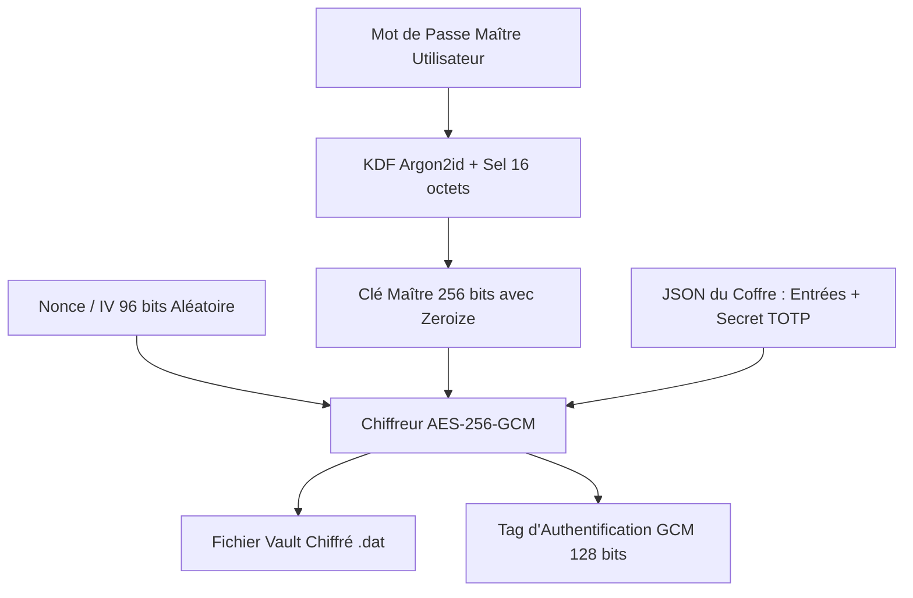
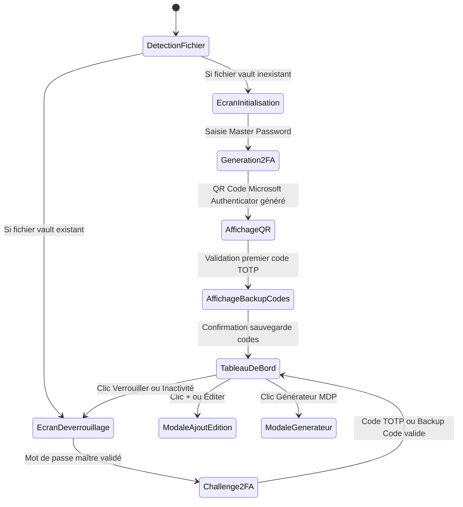

# Patterns Système & Architecture — P2TSecret (Rust + egui)

## 1. Principes Fondamentaux d'Architecture
- **Zero-Plaintext & Zeroize** : Aucun mot de passe ni clé secrète n'est jamais stocké en texte brut. En mémoire RAM, toutes les structures sensibles implémentent `Zeroize` et `ZeroizeOnDrop` pour être immédiatement écrasées dès la sortie du scope.
- **Chiffrement Authentifié de Niveau Militaire** :
  1. Dérivation de clé maîtresse avec **Argon2id** (paramètres résistants aux attaques ASIC/GPU).
  2. 2FA TOTP obligatoire (RFC 6238, 30s, 6 digits) compatible avec **Microsoft Authenticator** et Google Authenticator.
  3. Chiffrement authentifié de la base de données / coffre avec **AES-256-GCM** (nonce 96 bits unique à chaque écriture + tag d'authentification 128 bits pour validation d'intégrité).
- **Zéro Surface d'Attaque Web** : Interface native en mode immédiat avec `egui` / `eframe` en Rust pur. Zéro DOM, zéro JavaScript, zéro WebView.

## 2. Pile Technologique Rust
- **Moteur Graphique & Fenêtrage** : `eframe` = 0.27 / `egui` = 0.27
- **Chiffrement** : `aes-gcm` = 0.10, `argon2` = 0.5, `zeroize` = 1.8
- **2FA Microsoft Authenticator** : `totp-rs` = 5.6 (compatibilité RFC 6238), `qrcodegen` = 1.8
- **Sérialisation / Format** : `serde` = 1.0, `serde_json` = 1.0
- **Aléatoire Cryptographique** : `rand` = 0.8
- **Clipboard Sécurisé** : `arboard` = 3.4

## 3. Schéma Cryptographique du Coffre (Vault)

## 4. Machine à États de l'Interface UI (AppState)

